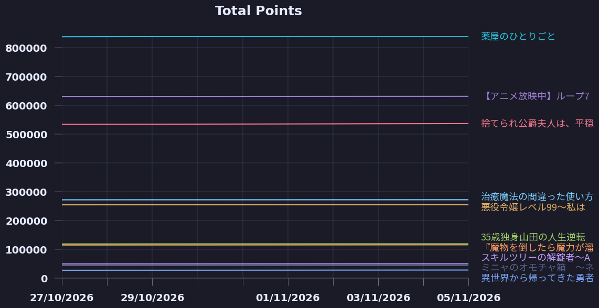
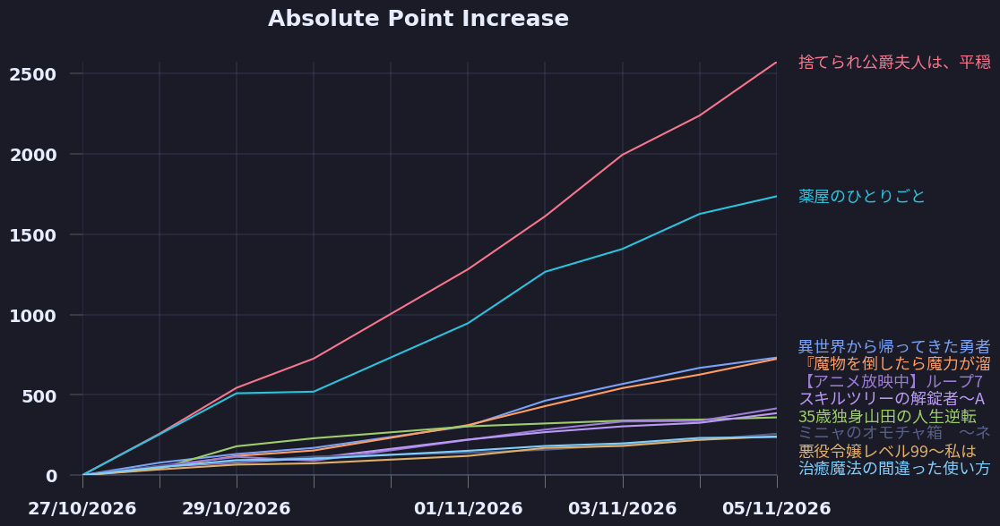

# SyosetsuMining

## Trending

1. [捨てられ公爵夫人は、平穏な生活をお望みのようです](https://ncode.syosetu.com/n4395il/)
2. [薬屋のひとりごと](https://ncode.syosetu.com/n9636x/)
3. [異世界から帰ってきた勇者は既に擦り切れている。](https://ncode.syosetu.com/n1368io/)
4. [『魔物を倒したら魔力が溜まる』というスキルを授かり「本末転倒！」と僻地に追放されましたが、おかげさまで廃墟のリノベーションがはかどります](https://ncode.syosetu.com/n2256im/)
5. [35歳独身山田の人生逆転魔法　～現代社会に疲れた俺は異世界でスローライフを楽しむために現代で悪魔と戦って金儲けをしながら異世界村を発展させることにしました～](https://ncode.syosetu.com/n3115io/)
6. [【アニメ放映中】ループ7回目の悪役令嬢は、元敵国で自由気ままな花嫁生活を満喫する](https://ncode.syosetu.com/n1784ga/)
7. [スキルツリーの解錠者〜A級パーティーを追放されたので【解錠&施錠】を活かして、S級冒険者を目指す〜](https://ncode.syosetu.com/n2693io/)
8. [ミニャのオモチャ箱　～ネコミミ少女交流記～](https://ncode.syosetu.com/n6187io/)
9. [悪役令嬢レベル99～私は裏ボスですが魔王ではありません～（←このタイトル間違いでした。本作は”光の魔法と勇者様”です）](https://ncode.syosetu.com/n0284ev/)
10. [治癒魔法の間違った使い方～戦場を駆ける回復要員～](https://ncode.syosetu.com/n2468ca/)
